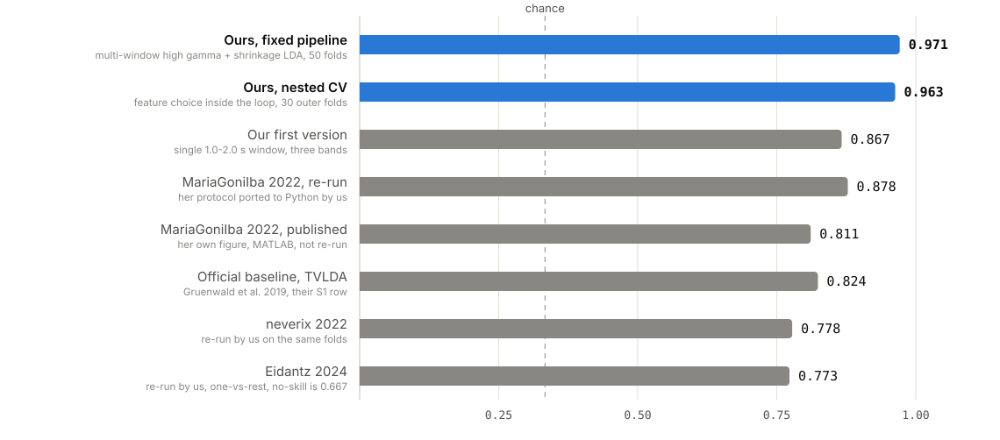
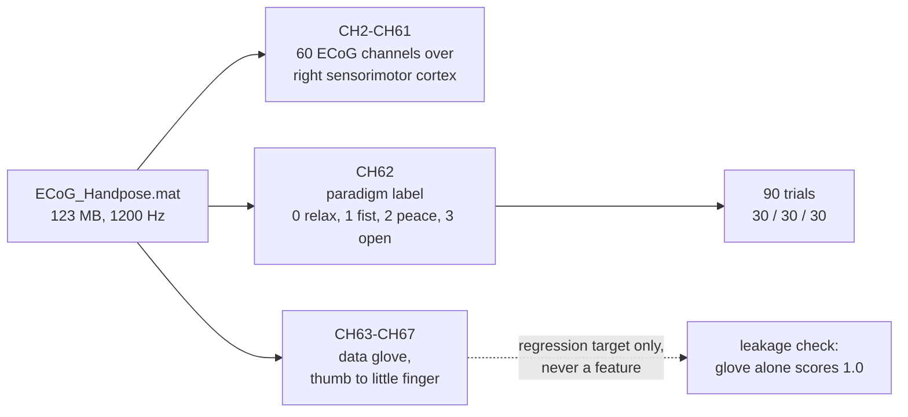
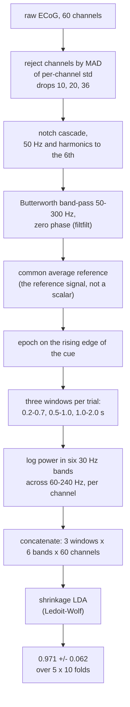
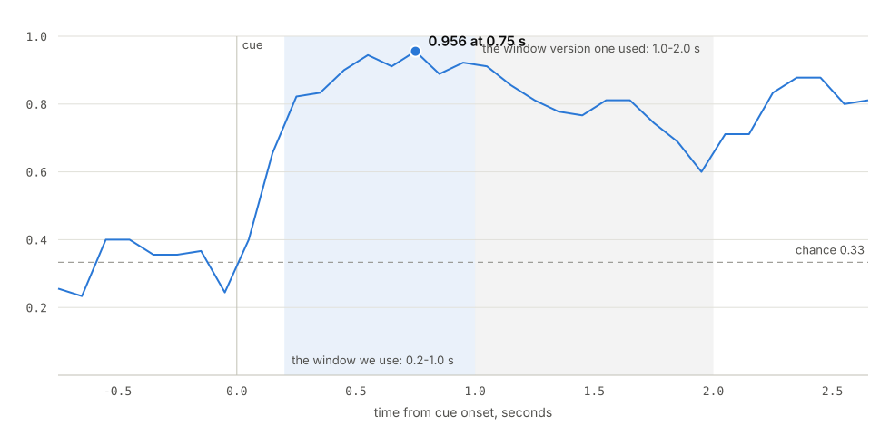
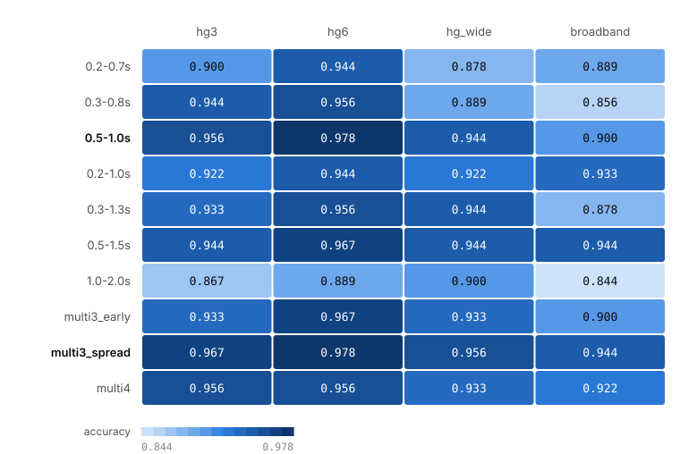
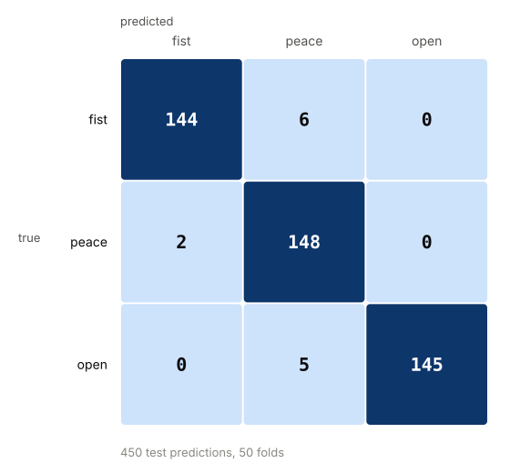
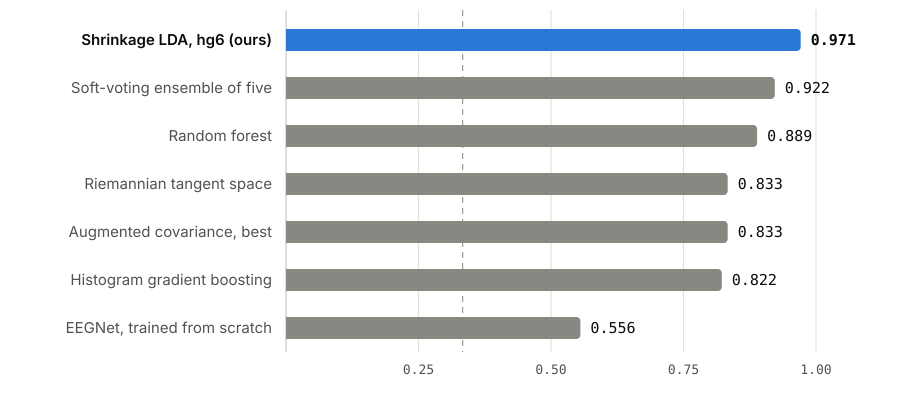
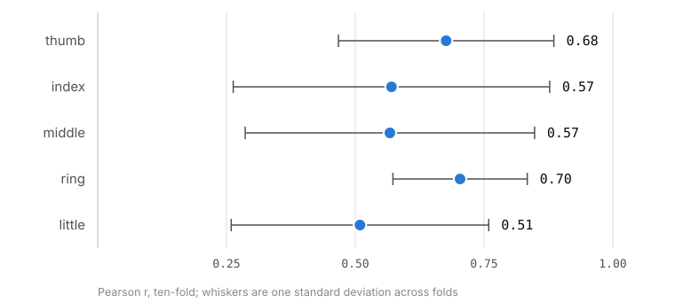

# ECoG hand pose, BR41N.IO at IEEE SMC 2026

**The task.** Decode which of three hand gestures a patient was cued to make, from a
60-channel ECoG grid over right sensorimotor cortex. The gestures are rock-paper-scissors:
fist, peace sign, open hand. The recording holds 90 trials from one session with one
patient, sampled at 1200 Hz, 30 trials per gesture, which puts chance at 0.333.

**The data.** `ECoG_Handpose.mat` from the BR41N.IO hackathon pack. Indexed at
[unicorn-bi/Hackathon](https://github.com/unicorn-bi/Hackathon), downloaded from
[g.tec](https://www.gtec.at/downloads_QyTs23/Hackathon/ecog-hand-pose.rar) as a 115 MB
`.rar`. It is not in this repository. `./fetch_dataset.sh` fetches and verifies it.

**The baseline.** The paper behind the recording travels in the same archive, and it is
what we compete against:

> Gruenwald J, Znobishchev A, Kapeller C, Kamada K, Scharinger J, Guger C (2019).
> **Time-Variant Linear Discriminant Analysis Improves Hand Gesture and Finger Movement
> Decoding for Invasive Brain-Computer Interfaces.** *Frontiers in Neuroscience* 13:901.
> [doi:10.3389/fnins.2019.00901](https://doi.org/10.3389/fnins.2019.00901)

Its best method on this subject reaches **0.824**. The same file has also been used by
four public hackathon projects, the best of which reaches **0.878** when we re-run it.

**Our result.** **0.971 ± 0.062** over 50 test folds with a fixed pipeline, and
**0.963 ± 0.060** once the choice of feature set moves inside the cross-validation. The
second number is the one we compare on: **+13.9** points over the official baseline,
**+8.5** over the best earlier method re-run on our own folds. A 200-permutation test
returns p = 0.005, its own floor at 1/201.

The classifier is a shrinkage LDA on log band power, the same linear model our first
version used at 0.867. The gain came from which second of the trial gets analysed.

## Before anything runs: two downloads

Nothing large is committed here. The recording and the four earlier projects are fetched,
and `./fetch_dataset.sh` with `./clone_prior_art.sh` do both. By hand it is this.

**The recording.** Download
[ecog-hand-pose.rar](https://www.gtec.at/downloads_QyTs23/Hackathon/ecog-hand-pose.rar),
unpack it, and put `ECoG_Handpose.mat` in the repository root. It has to be
123 246 843 bytes with sha256
`b2b65f0f040ee9663c523801d92ba7e685d2ade94a2c1592c9975320966fab60`.

**The four earlier projects.** Clone each at the commit we audited, into the directory
named beside it:

| Clone this | At this commit | Into |
|---|---|---|
| [MariaGoniIba/BR41N.IO-Hackathon-ECoG-Epilepsy](https://github.com/MariaGoniIba/BR41N.IO-Hackathon-ECoG-Epilepsy) | `e2e6159` | `prior-art/maria-helper/BR41N.IO-Hackathon-ECoG-Epilepsy/` |
| [neverix/ecog-br41n-2022](https://github.com/neverix/ecog-br41n-2022) | `4833d17` | `prior-art/neverix-helper/ecog-br41n-2022/` |
| [Eidantz/br41n.io_Hackathon_ECoG](https://github.com/Eidantz/br41n.io_Hackathon_ECoG) | `e1b6f6a` | `prior-art/eidantz-helper/br41n.io_Hackathon_ECoG/` |
| [bkowshik/br41n-ecog-hand-pose](https://github.com/bkowshik/br41n-ecog-hand-pose) | `41ad6d2` | `prior-art/bkowshik-helper/br41n-ecog-hand-pose/` |

`./clone_prior_art.sh --check` prints which of the four are present and whether each sits
at its pin. Our own results do not need them: they are what the prior-art runners measure,
and what `prior-art/*/metrics.json` already holds the output of.



Every bar in that figure was produced by code in this repository, except the official
baseline, which is quoted from the paper's own table. Two of the hackathon projects never
published a number, and this is the first time either has been measured.

## The recording and its official baseline

In each trial a photograph of the gesture is on screen for 2 s, followed by a black screen
for 2 to 3 s. Each trial has an onset phase and a hold phase, and the two carry different
amounts of information, which is the finding this submission turns on.

The archive unpacks to the recording, `data_description.pdf` and `Hand.pdf`, the last of
these being the Gruenwald paper cited above. Its fourth table reports seven methods per
subject, each on 20 repetitions of a randomised 10x10 cross-validation. The abstract
quotes 99 % for three gestures, but that average covers the high-density grid subjects,
and this recording is not one of them.

`./fetch_dataset.sh` downloads the archive, unpacks it and checks the recording against
sha256 `b2b65f0f040ee9663c523801d92ba7e685d2ade94a2c1592c9975320966fab60`.

The subject here is their **S1**, identified by trial count: 30 per class, where their
other rock-paper-scissors subjects have 40, 76 and 60, on a right-hemisphere grid of
standard spacing as S1's was. The archive itself doesn't name a subject, and the paper
used 20 of S1's 98 electrodes where the released file holds 60 channels, so the inputs
stay unequal even with the subject settled. Their S1 row:

| Method | Accuracy |
|---|---|
| LDA + channel selection | 0.522 ± 0.031 |
| LDA + CSP | 0.638 ± 0.030 |
| Regularised LDA, vectorised features | 0.688 ± 0.025 |
| Whitened rLDA + PCA | 0.654 ± 0.015 |
| Whitened LDA + channel selection | 0.691 ± 0.009 |
| Whitened LDA + CSP | 0.738 ± 0.020 |
| **Whitened TVLDA + PCA** | **0.824 ± 0.020** |

Our 0.963 is 13.9 points above their best method on this subject. Those numbers are transcribed from that table
rather than re-run. `prior-art/official-baseline.json` records that, along with the
identification argument above, and the figure reads the baseline from that file.

The channel map, as the dataset documentation gives it:

| Channel | Contents |
|---|---|
| CH1 | sample time |
| CH2 to CH61 | ECoG, raw and DC-coupled, right sensorimotor cortex |
| CH62 | paradigm label: 0 relax, 1 fist, 2 peace, 3 open hand |
| CH63 to CH67 | data glove, thumb to little finger |



The glove channels are a regression target and never a classifier feature. An LDA
trained on the glove alone scores **1.0**, because the glove is the instrument that
measures the gestures. Any work that lets it into the feature matrix reports a
meaningless accuracy.

### CH62 is the cue, not a device's answer

Some hackathon packs include a device's own classification beside a hand-made ground
truth and ask you to beat the device. This one does not, and `python -m ecog.data` is the check
rather than our word for it:

| Measured | Value |
|---|---|
| discrete channels in the file | CH62 only, the other 66 are continuous |
| distinct values on CH62 | 0, 1, 2, 3 |
| blocks | 90, exactly 30 per class |
| block length | 2.00 to 2.04 s, the documented cue presentation |
| gap length | 2.08 to 12.08 s, the documented 2 to 3 s black screen and the longer breaks |
| class-to-class transitions | 0, every block starts from relax |

A classifier's output would not be a clean rectangle lasting exactly as long as the
photograph was on screen. CH62 is the stimulus marker, so the baseline to beat is not
inside the file. It is in the paper above.

## What had already been done on this recording

The same file is used by four public projects. We ran all of them, and report what came
out. Two further BR41N.IO repositories we found are not here: `neverix/ecog-video-br41n-2023` is
empty, and `GoTHxD4rKnEss/ecog-video` uses a different recording (160 channels plus
video), so neither is comparable.

| Project | Year | Stack | Claimed | Measured by us | Runner |
|---|---|---|---|---|---|
| [MariaGoniIba](https://github.com/MariaGoniIba/BR41N.IO-Hackathon-ECoG-Epilepsy) | 2022 | MATLAB, random forest | 0.811 three gestures, 0.789 rest vs movement | **0.878** with her protocol ported to Python | `maria-helper/run.py` |
| [neverix](https://github.com/neverix/ecog-br41n-2022) | 2022 | MNE, pyriemann, giotto-tda | 0.923 to 0.944 | **0.756 to 0.778** on a fixed protocol | `neverix-helper/run.py` |
| [Eidantz](https://github.com/Eidantz/br41n.io_Hackathon_ECoG) | 2024 | MNE, pyriemann `TSclassifier` | nothing published | **0.773** one-vs-rest, against a 0.667 no-skill floor | `eidantz-helper/run.py` |
| [bkowshik](https://github.com/bkowshik/br41n-ecog-hand-pose) | 2026 | nbdev, MNE, PyTorch | nothing executed | 84 code cells, 0 with an output | `bkowshik-helper/run.py` |

Each helper's README has the detail. The parts that matter for our submission are
these.

### The highest claim does not survive a fixed protocol

The neverix notebooks print up to 0.944. That is the maximum over several dozen
configurations, read off the same resamples it was measured on. Run the same feature
stack once per protocol, with CSP fitted inside each fold, and it gives 0.756 to 0.778
on their own 16 x 3-fold scheme as well as on ours. This is not an accusation of error.
It is the standard failure mode of a 48-hour hackathon, and we had to address it
because it is the number we get compared against.

### One-vs-rest hides a 0.667 floor

Eidantz classifies one gesture against the other two (`labels1[labels != j] = 0`). On
balanced 3-class data, answering "not this gesture" every time is already correct two
thirds of the time. Reproduced, with the baseline computed per fold:

| Gesture vs rest | Accuracy | Majority baseline | Gain |
|---|---|---|---|
| fist | 0.733 | 0.663 | +0.070 |
| peace sign | 0.719 | 0.678 | +0.041 |
| open hand | 0.867 | 0.659 | +0.208 |
| **mean** | **0.773** | **0.667** | **+0.106** |

The gain over having no model is about 10 points, while 0.773 on a slide reads like a
real three-class accuracy.

### Fixing the bug in the published MATLAB makes it worse

`preprocessing.m` subtracts `med_s(i)`, one scalar per channel, where a common average
reference subtracts the reference signal `med_s`. The spatial filter never happens. We
expected correcting it to help. It does the opposite: 0.878 drops to 0.622. On a grid
where most channels carry the task response, the median across channels largely is the
signal, so removing it removes what the classifier needs. Our own pipeline references
after band-passing and uses the mean, and does not collapse this way.

Her second bug is why the published table reads `142` and `73`: `Results.Acc` in `RF.m`
counts correct trials instead of rating them, and the author marked that line
`%corregir!` herself.

### Two of the four never published an honest number

Eidantz published none. bkowshik built the best-organised codebase on this dataset,
with nbdev, eleven notebooks and real modules, and never ran it:
`bkowshik-helper/run.py` walks every notebook and finds 84 code cells, none carrying an
output, 26 of them marked `#| eval: false`.

That project is still the most useful of the four to us. It carries the recording through
git-lfs, which is our fallback if the official download is unavailable, and
`nbs/09_benchmark.ipynb` collects the literature ranges we compare against.

## Our method



`ecog/data.py` is the only preprocessing path, shared by our models and by every
prior-art reproduction, so a comparison differs by method and by nothing else.
Evaluation is `StratifiedKFold(10)` throughout, repeated where stated.

### The measurement the result rests on

A 0.5 s window slid in 0.1 s steps from -1 to 3 s relative to the cue, same LDA:



Discriminability peaks between 0.5 and 1.0 s after the cue, at 0.956 ± 0.074 with the
window centred on 0.75 s. Before the cue it sits at chance. By a centre of 1.95 s it
has fallen to 0.600. The canonical window of 1 to 2 s, used by MariaGoniIba and in
practice by everyone else, analyses the data after the peak. The difference between
0.956 and 0.867 is the window, not the model.

For a BCI that says something concrete. A confident decision is available about 0.75 s
after intent appears, and the posture-hold phase is less informative than the onset.

### Window against band set



Six 30 Hz bands beat three wide ones in almost every window. The best single cell is
`0.5-1.0 s / six bands` at 0.978. Rather than pick it, the final pipeline concatenates
three windows, which removes the choice.

| Measured | Protocol | Accuracy |
|---|---|---|
| Best single feature set, `0.5-1.0 s / six bands` | 10 folds | 0.978 |
| **Fixed pipeline, three windows concatenated** | **5 x 10 folds, 50 estimates** | **0.971 ± 0.062** |
| **Nested CV over all 40 candidate feature sets** | 3 x 10 outer folds, choice on 5 inner | **0.963 ± 0.060** |
| Our first version, window 1 to 2 s, three bands | 10 folds | 0.867 ± 0.083 |

The nested 0.963 answers the objection we raise against neverix. The search over 40
feature sets lies entirely inside the cross-validation, and the test part of a fold
never participates in the choice. The gap between 0.978 by search and 0.963 under nesting
is 1.5 points, so selection bias on this data is small. The inner folds pick the six-band
set in 29 of 30 cases.

Permutation test on the fixed pipeline: observed 0.978 against 200 permutations,
p = 0.00498, which is the floor at 200 permutations.

### Which gestures the model confuses



Summed over 50 folds. Fist and open hand are never confused with each other, and every
error is between neighbouring classes. The first version showed the same structure with
the fist in the middle, which fits the fist being closest to rest in high-gamma
pattern.

### Models we tried



The negative results are in the table because they are the answer to "did you try".

| | Accuracy | Reading |
|---|---|---|
| Augmented covariance matrices (Carrara & Papadopoulo, IEEE TBME 71(9) 2024, arXiv:2302.04508) | 0.789 to 0.833, 0.822 nested | A 2024 method built so a covariance classifier sees temporal structure, and it beats plain Riemannian methods on MOABB. Here the gesture is in the 60-240 Hz power envelope rather than in the phase relations the embedding adds. |
| Soft voting over five representations | 0.922 | Below its own best member at 0.944. |
| Histogram gradient boosting | 0.822 | Worse than the linear model. |
| EEGNet, trained from scratch (PyTorch, CUDA) | 0.556 | Below the published EEGNet range of 0.65 to 0.75. The limit is 90 trials, not model capacity. |

At 90 trials the simplest model with the right features wins, which is what this table
is for.

The EEGNet row has no fold spread next to it. Its mean reproduces exactly on a different
GPU but the spread does not, because cuDNN convolution kernels are not deterministic: we
measured 0.141 on an RTX 3060 and 0.149 on an RTX A4000. Everything else here is
bit-reproducible on CPU, and `verify.py` checks that one as a range.

### Rest against movement

| Source | Protocol | Accuracy |
|---|---|---|
| MariaGoniIba, published | her own CV | 0.789 |
| MariaGoniIba, her protocol ported by us | 10 folds | 0.800 ± 0.071 |
| Our first version, window 1 to 2 s, three bands | 10 folds | 0.744 ± 0.079 |
| **Ours, rest taken 1.2 to 0.2 s before the cue** | **5 x 10 folds** | **0.799 ± 0.084** |

Our first version came in below the published number and we said so. The cause was the
same window problem. With the final feature set we reach 0.799, level with her protocol
and not a win. The substantive finding runs the other way: telling rest from movement
on this recording is harder than telling the three gestures apart. The confusion matrix
at 0.799, rows rest then movement, summed over 50 folds:

```
[[400,  50],
 [131, 319]]
```

Rest is recognised almost always. Movement is taken for rest in 29 % of trials, and
part of that is trials that start late relative to the label.

### Continuous finger flexion



Ridge (alpha = 10) on the glove channels, 10 folds, Pearson r between predicted and
measured flexion. The mean is **r = 0.605**, against a literature range of 0.45 to 0.60
for linear models (Liang & Bougrain 2012) and 0.55 to 0.70 for deep CNNs (Xie 2018), as
collected in the bkowshik clone's `nbs/09_benchmark.ipynb`.

The caveat belongs in the open, before anyone asks. R² is negative for three fingers
out of five. The model recovers the shape of the flexion and not its magnitude. It
reconstructs a movement profile rather than measuring an angle.

No previous project on this recording ran glove regression at all. bkowshik wrote
`regression.py` and never executed it.

## Where we land

Same file, same preprocessing, same folds, except where stated.

| Source | Protocol | Accuracy | Δ vs our nested 0.963 |
|---|---|---|---|
| **Ours, fixed pipeline** | 5 x 10 folds, three windows, six bands, LDA | **0.971** | |
| **Ours, nested** | 3 x 10 outer folds, choice inside | **0.963** | the honest estimate |
| neverix, as printed in their notebook | maximum over a configuration grid | 0.923 to 0.944 | +0.019 to +0.040, against a biased estimate |
| MariaGoniIba, her protocol re-run by us | 10 folds | 0.878 | **+0.085** |
| Our first version | 10 folds, window 1 to 2 s, three bands | 0.867 | **+0.096** |
| **Official baseline, whitened TVLDA** | their 20 x (10 x 10) CV on this subject | **0.824** | **+0.139** |
| MariaGoniIba, as published | her own CV, MATLAB | 0.811 | **+0.152** |
| neverix, re-run by us | 16 x 3 folds and 10 folds | 0.756 to 0.778 | **+0.185 to +0.207** |
| Eidantz, re-run by us | one gesture against the other two | 0.773, where always answering "not this one" gets 0.667 | not a three-class number |
| bkowshik | no benchmark was executed | | nothing to compare |

Every delta in that column is measured from 0.963, the nested estimate, rather than
from the higher 0.971. The nested number is the one with no choice left outside the
cross-validation, so it is the one to compare on.

The table holds three comparisons on purpose. Against the official baseline from the paper
behind the dataset we are +13.9 points. Against the best published hackathon number we are
+15.2. Against the best earlier method re-run by us on the same folds we are +8.5, and that
last one is the strictest, because it is the only one measured on our own folds.

The gain came from time and frequency resolution rather than from the model. The
classifier stayed a shrinkage linear discriminant throughout.

`python verify.py` re-reads every number above out of the result JSON and fails if this
README has drifted from it.

## What we did not do

We did not re-run the official TVLDA baseline. Its numbers are transcribed from the
paper's fourth table, and nobody has published TVLDA as code. Our comparison against it
is a comparison against a published figure, on a subject we identified rather than one
the archive names.

We did not execute the MariaGoniIba MATLAB, because it needs toolboxes we do not have.
Her protocol is ported to Python instead, which reproduces her trial counts exactly but
is not her binary.

We did not reproduce the topological features of neverix (giotto-tda). Our reproduction
of their stack covers band power, Welch PSD and CSP.

The finger regression is uncalibrated, and it was not moved to the final window and
band set. The r = 0.605 comes from the first pipeline, so there is probably headroom
there.

Everything is measured on one patient and one recording. Cross-session and
cross-subject transfer were not tested, because the dataset contains neither.

## What is in here

| Path | Contents |
|---|---|
| `ecog/data.py` | the one preprocessing path: load, reject, notch, band-pass, reference, epoch, features |
| `ecog/models.py` | the classifiers, the cross-validation they are scored with, the permutation test |
| `ecog/eegnet.py` | EEGNet, kept for its negative result |
| `ecog/baseline.py` | run one, on the published window: every classical model, plus the sliding-window curve |
| `ecog/search.py` | run two: windows by band sets, and four ideas that did not work |
| `ecog/final.py` | run three: the pipeline we submit, measured three ways |
| `ecog/prior.py` | protocols from earlier work, re-implemented so they score on our folds |
| `ecog/svg.py`, `ecog/charts.py`, `ecog/figures.py` | the figures, drawn from the result files |
| `results/recording.json` | the recording described without a model: channel map, checksum, and the measurement that CH62 is the cue |
| `results/*.json` | what the runs wrote |
| `results/*.svg` | the figures below |
| `verify.py` | checks every number in this README against those files |
| `prior-art/<name>-helper/` | one directory per earlier project. `clone_prior_art.sh` puts the upstream repository inside, beside the `run.py` that measures it, the `metrics.json` that run writes and a `README.md` comparing claim against measurement |
| `prior-art/maria-helper/car_fix.patch` | a diff against the pinned commit fixing two bugs in the published MATLAB, so her clone itself stays unmodified |
| `fetch_dataset.sh` | downloads and unpacks the official archive against its sha256, with the bkowshik project's git-lfs copy as a fallback |
| `clone_prior_art.sh` | clones the four earlier projects at their pinned commits, or reports which are present with `--check` |
| `prior-art/official-baseline.json` | the baseline we compete against, taken from the fourth table of the paper that comes with the dataset, with the citation and which subject this recording is |
| `pyproject.toml`, `.gitignore`, `.slopignore`, `LICENSE` | dependencies and the package; the recording and the four clones kept out of git; the clones and two false-positive lint rules exempted from our own prose and code linting; MIT |

No third-party file is committed here. Each earlier project is cloned on demand at the
commit we audited, which `./clone_prior_art.sh --check` prints.

## Running it

```bash
git clone <this repo> && cd <this repo>
pip install -e '.[all]'

./fetch_dataset.sh          # the recording: official archive, unpacked, checksum-verified
./clone_prior_art.sh        # the four earlier projects, each at the commit we audited
```

Neither script puts anything into git. The recording and the four clones are listed in
`.gitignore`, so what is committed here stays our own work.

Everything below then runs. Only the EEGNet comparison uses a GPU.

```bash
python -m ecog.data                               # 2 s, describes the recording
python -m ecog.baseline                           # 5 min
python -m ecog.search                             # 9 min
python -m ecog.final --jobs 8                     # 5 min, or 55 min with --jobs 1
python prior-art/maria-helper/run.py              # 50 s
python prior-art/eidantz-helper/run.py            # 15 s
python prior-art/bkowshik-helper/run.py           # under 1 s
python prior-art/neverix-helper/run.py            # 17 min
python -m ecog.figures                            # redraws results/*.svg
python verify.py                                  # README against the JSON
```

Each run writes one file: ours into `results/`, each prior-art runner into its own
helper directory. `ecog.figures` reads those files and nothing else, so no number
reaches a figure by hand, and `verify.py` fails if a number in this README has drifted
away from them.

`--jobs` changes the wall clock only. Folds and permutations are drawn in one sequence
and consumed in order, so the output is the same at any worker count.

If an editable install is awkward in your environment, `PYTHONPATH=. python ...` works
for every command above.

### This was checked rather than assumed

Everything above was run from a clean clone on a rented 24-core box with an RTX A4000:
dependencies from `pyproject.toml`, the recording through `fetch_dataset.sh`, all seven
runs, then a comparison of the fresh JSON against what is committed here.

588 values compared, 584 identical to four decimals. Three of the four that moved were
float noise below the fourth decimal from a different BLAS build. The fourth is real:
the EEGNet spread across folds, because cuDNN convolution kernels are not
deterministic. Its mean reproduced exactly.

That run also found two defects, both fixed. The runs resolved `--data` relative to the
working directory, so the commands above only worked from one directory. And the
parallel map in `ecog/final.py` did not cap BLAS threads inside its workers, so
`--jobs 8` asked a 23-core box for about 80 threads and ran slower than one worker.

## License

MIT, see `LICENSE`. Every referenced repository stays under its own license, held by its
own authors. None of their files are redistributed here.
